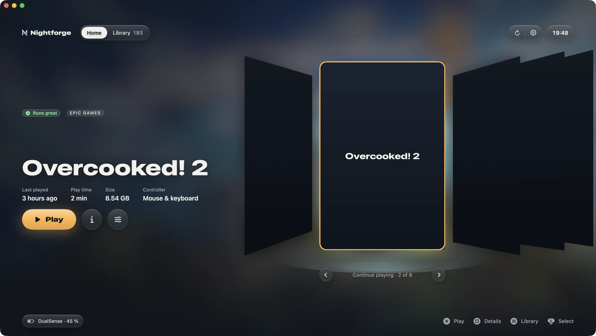
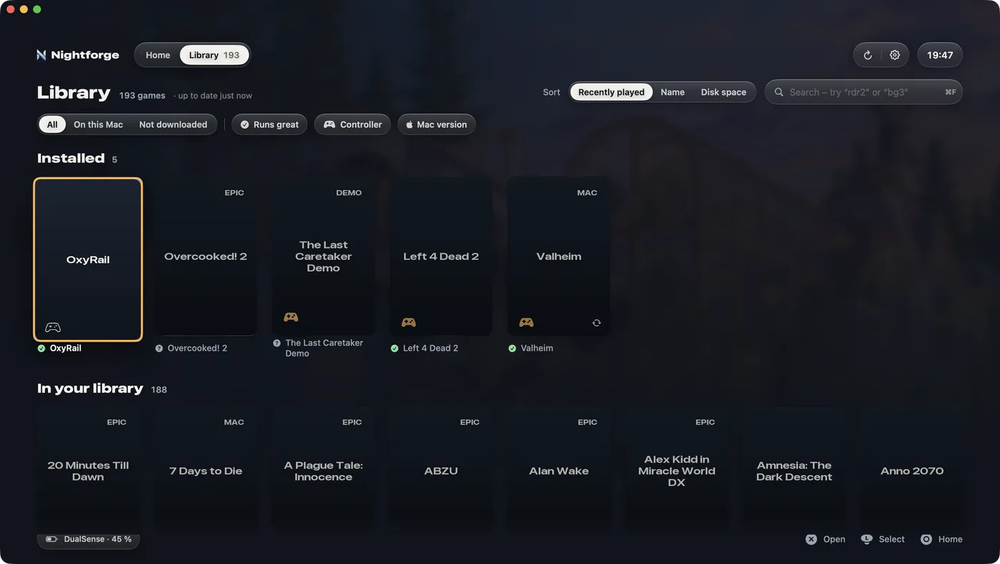
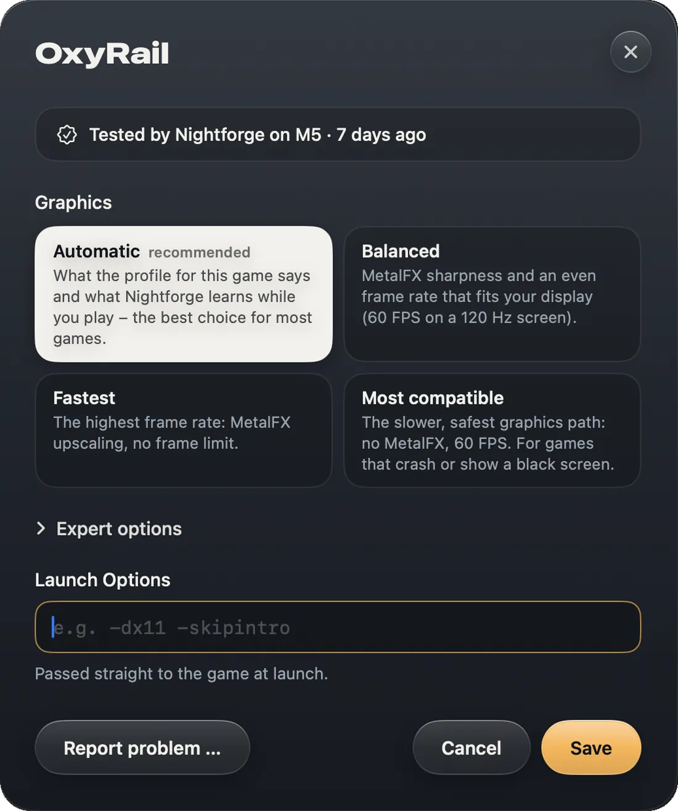
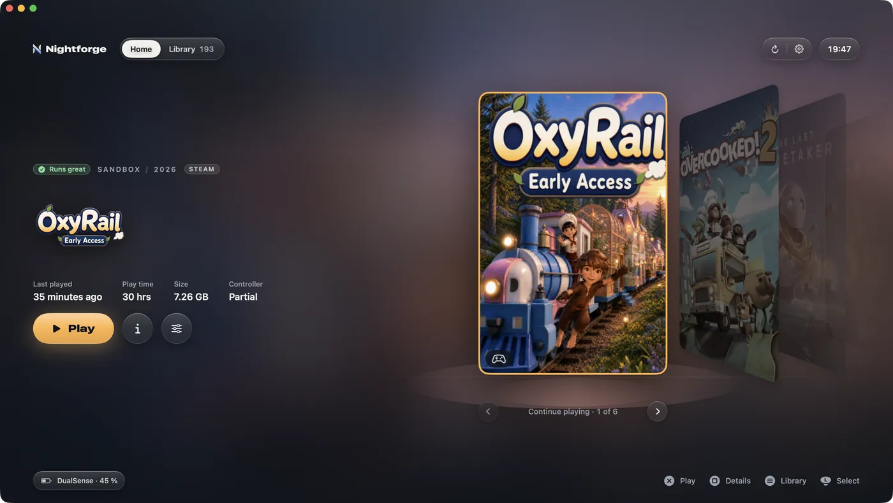
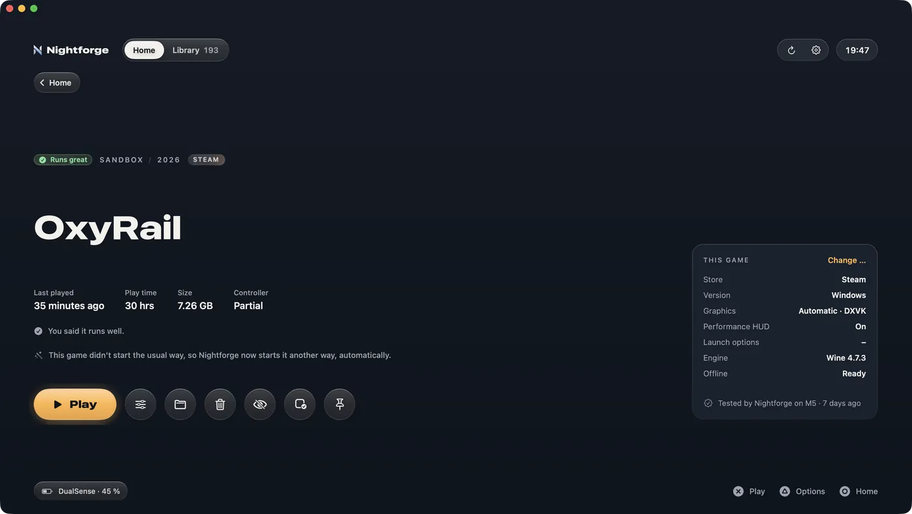
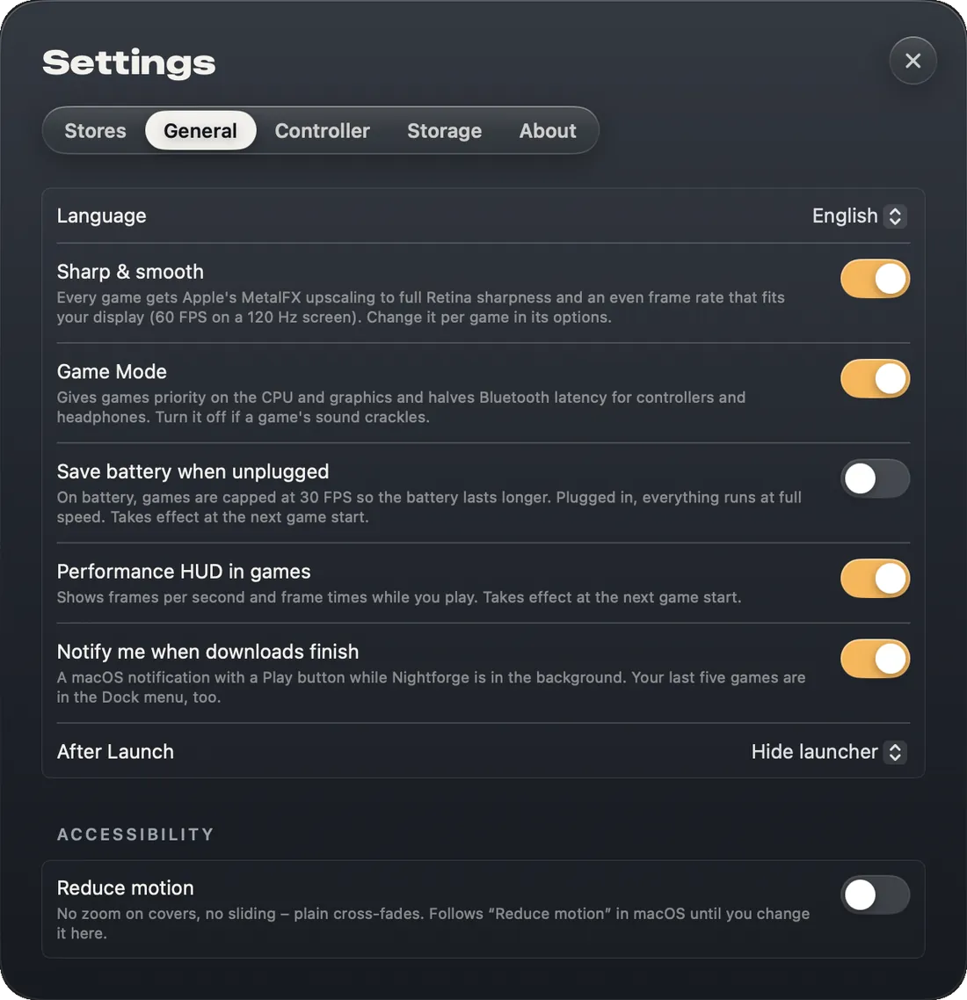
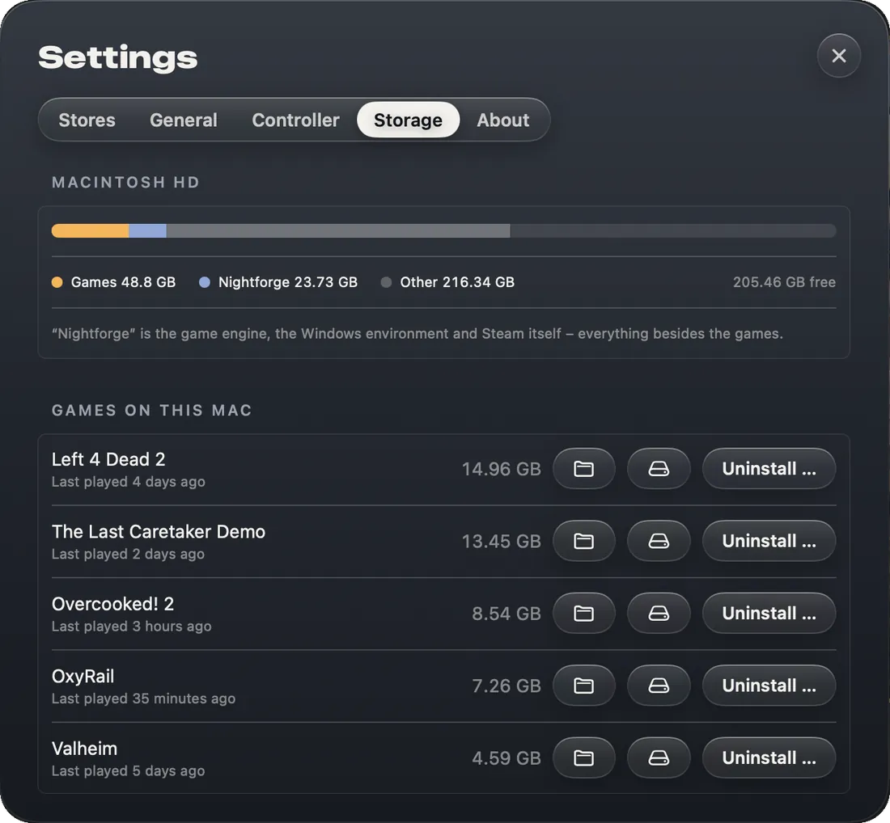

<p align="center">
  
</p>

<h3 align="center">Your Steam, Epic and GOG games on an Apple silicon Mac.<br>Free, one click, no fiddling.</h3>

<p align="center">
  <a href="https://github.com/LordHayne/Nightforge/releases/latest"><b>Download</b></a> ·
  <a href="#install">Install</a> ·
  <a href="#what-nightforge-does">What it does</a> ·
  <a href="#good-to-know">Good to know</a> ·
  <a href="#whats-next">What's next</a> ·
  <a href="#how-it-works">How it works</a>
  <br>
  <sub>Free · Apple silicon (M1 or newer) · macOS 26 (Tahoe) or later · English and German · GPL-3.0</sub>
</p>

<p align="center">
  
</p>

Nightforge sets up everything a game needs on your Mac and then gets out of the way. Connect Steam once, and your whole library shows up as covers; connect Epic Games and GOG too if you like. If a game has a Mac version, that's what you play. If not, its Windows version runs – sharp, smooth and set up by itself. Switch it on and enjoy.

## What Nightforge does

### Mac versions first

When a game also comes for the Mac, Nightforge plays the Mac version – without any Windows translation. GOG's Mac versions come straight from GOG; for Steam, Nightforge sets up Valve's Steam for Mac once. A small **MAC** tag shows which games run that way. If a Mac version fails, the Windows version takes over at once, and your saves come along.

<p align="center">
  
</p>

### Sharp & smooth, by itself

Most Windows games get Apple's MetalFX upscaling to full Retina sharpness, and games get an even frame rate that fits your display – 60 FPS on a 120 Hz screen. Nothing to set up; each game's options still offer four graphics routes in plain words. DirectX 10 and 11 go straight to Metal through DXMT, DirectX 12 through Apple's D3DMetal (once you agree), DirectX 9 through Wine's own WineD3D.

| Measured on an M5 with Nightforge 0.2 | DXMT (Nightforge) | Vulkan route |
|---|---:|---:|
| OxyRail | ~75 FPS | 45–50 FPS |
| 7 Days to Die | ~63 FPS | ~30 FPS |

DirectX 12 through D3DMetal: the Black Myth: Wukong Benchmark Tool averages 68 FPS (Low, FSR, 1512×982, M5, Nightforge 0.3).

<p align="center">
  
</p>

### Steam, Epic and GOG in one place

Your Steam, Epic and GOG games show up together. Nightforge downloads and starts Epic and GOG games itself – no Epic launcher, no GOG Galaxy – through [legendary](https://github.com/derrod/legendary) and [gogdl](https://github.com/Heroic-Games-Launcher/heroic-gogdl). You sign in in each store's own window; Nightforge never sees your login. GOG's games are DRM-free, so they play without internet and without signing in. Games you own in more than one store show up once, and you choose which store starts them.

### Made for the couch

Playing, downloading, options and settings work with a controller, L1/R1 switch between Home and the library, and the pointer hides until you move the mouse again; signing in and searching still need a keyboard. PlayStation and Xbox controllers are recognised by themselves, the hints switch to your controller's own buttons, and a badge on every cover shows which games play with one. On a TV, games start full screen at its resolution, sound goes over HDMI, and when a game ends you're back in Nightforge like on a console, not on the desktop. Full screen needs no Space of its own, so nothing slides aside at the start or the end, and a loading screen covers the wait. Keyboard and trackpad work everywhere too.

**Nightforge's own controller menu.** Press both sticks (L3 + R3) and hold them for two seconds, and a calm menu comes up in the middle of any game: keep playing, quit the game – even when it hangs – or go back to Nightforge. So on the couch you never get stuck: you quit a frozen game with the controller, without getting up, and you're straight back in your library.

<p align="center">
  
</p>

### Welcome back

After every game Nightforge shows how long you played and asks how it ran. It remembers that for the next start and for how it rates the game on your Mac – the answer stays on your Mac. A game's page shows what you said, what Nightforge starts it with, where its settings come from and whether it starts without internet – along with the game's description, screenshots and game modes.

<p align="center">
  
</p>

### And more

- **Continue playing.** Home puts your pinned games first, then what you played lately. One button and you're back in.
- **Fixes that arrive by themselves.** A game database is rebuilt every night from the community fixes behind Proton, plus our own profiles tested on Macs. The right one applies silently at launch.
- **Self-healing starts.** If a game doesn't start the usual way, Nightforge starts it another way, by itself. If the newest engine crashes a game, it goes back to the one before.
- **External drives.** Install games straight onto an external SSD, or move them there later.
- **macOS Game Mode.** Games get priority on the CPU and graphics, and controllers and headphones get half the Bluetooth latency.
- **Dock and notifications.** Right-click the Dock icon to start your last five games. A notification tells you when a download is done, and downloads keep your Mac awake.
- **Looks out for your battery.** A charger too weak for games shows at the top before the battery runs low; on battery, games can be capped at 30 FPS.
- **Store search.** Search also finds games in the Steam store, with price and Metascore; you buy in your browser, and they appear in your library. Free games you add right away with **Add for Free** – Steam asks once in its own window.
- **Big screen.** Plug in a monitor or TV, and Nightforge and your games move over to it by themselves.
- **Larger text and less motion.** One switch makes all of Nightforge's text a step larger; another turns zooming and sliding into plain cross-fades.
- **Free and quiet.** No account, no telemetry, no background service. A problem report opens on GitHub filled in with the game and its settings, and is public only once you submit it; error lines stay on your clipboard until you paste them.

### Settings in plain words

Nightforge is meant to be switched on and enjoyed; the defaults give the best result your Mac can deliver. Every switch says in one sentence what it does.

<table>
  <tr>
    <td width="50%"></td>
    <td width="50%"></td>
  </tr>
</table>

- **Stores:** connect Steam, Epic Games and GOG.
- **General:** language, Sharp & smooth, Game Mode, save battery when unplugged, performance HUD, notifications, what happens after a game starts, reduce motion and larger text.
- **Controller:** pair a controller and choose the button labels.
- **Storage:** what games, Nightforge and its caches take up; move or uninstall games, or remove Nightforge completely (saves that are only on your Mac are copied to Documents first).
- **Per game (O):** Automatic, Balanced, Fastest or Most compatible, plus expert options and launch options.
- **Advanced:** CrossOver and Whisky bottles or your own Wine, folded away until you need them.

## Tested on a Mac

Played live on a Mac with M5 between 24 October and 2 November 2026, with Nightforge 0.3 and the builds before it.

| Game | Store | Way | Result |
|---|---|---|---|
| Asphalt Legends | Steam | Mac version | Runs |
| Valheim | Steam | Mac version | Runs, with a controller too |
| No Man's Sky | Steam | Mac version | Runs |
| OxyRail | Steam | Windows · DXMT | Runs, a steady 60 FPS with MetalFX |
| Overcooked 2 | Steam | Windows · DXMT | Runs at 60 FPS, with a controller and on the TV too |
| Black Myth: Wukong Benchmark Tool | Steam | Windows · D3DMetal | Runs, 68 FPS (Low, FSR, 1512×982) |
| The Last Caretaker Demo | Steam | Windows · D3DMetal | Runs, around 50 FPS at full Retina resolution with FSR frame generation |
| Control | Epic Games | Windows · D3DMetal | Runs |
| Mafia II (Classic) | GOG | Windows · WineD3D | Runs, but not smooth yet |
| Overwatch | Steam | Windows | Doesn't start yet – Nightforge is looking into why |

Everything else: try it. Nightforge picks the way from a game's files and moves on to the next one by itself if a game doesn't start. Online games with anti-cheat are the exception (see Good to know).

## What's next

No dates – just an honest sort.

**Coming soon** – in the works, arriving with one of the next updates:

- **Search with a controller.** Jump to a first letter or use an on-screen keyboard – then search works without a keyboard too.
- **Games stay up to date.** Updates download in the background while Nightforge is open – like on a console.
- **Download queue.** Set the order, pause and resume, and download only at night if you like.

**Planned** – later, no date yet:

- **Save conflicts, solved.** When the save on your Mac and the one in the cloud differ, Nightforge asks before the start which one goes on, and backs up the other.
- **Faster for DirectX 9.** More speed for older DirectX 9 games through KosmicKrisp, a new Vulkan driver for the Mac.

## Install

You need a Mac with Apple silicon (M1 or newer) and macOS 26 (Tahoe) or later – the Windows engine is built for it. Open **Terminal** and paste:

```bash
curl -fsSL https://raw.githubusercontent.com/LordHayne/Nightforge/main/scripts/install.sh | bash
```

That installs the newest version into Applications and opens it.

On macOS 26.4 or later, Terminal may stop the paste with a warning. macOS shows it to anyone who rarely uses Terminal, because pasted commands are a common trick: it can't know what a pasted line does, so it asks you to make sure it comes from a source you trust. This line only downloads Nightforge from this repository, puts it in Applications and opens it – you can [read the script](scripts/install.sh) first. If you're fine with that, choose **Paste Anyway**. Nightforge updates itself from then on: when a new release is out, an **Update** button appears at the top – one click, and it restarts with the new version.

Prefer clicking? Download the DMG from the [latest release](https://github.com/LordHayne/Nightforge/releases/latest), open it and drag Nightforge onto the Applications folder. Nightforge is free and not registered with Apple, so on first launch macOS says it can't verify it: open **System Settings → Privacy & Security**, scroll down and click **Open Anyway**. The Terminal line skips this step.

<p align="center">
  
</p>

On the first start Nightforge sets up the game engine, a Windows environment and Steam. You only sign in, in Steam's own window – while it installs, you can try out your controller.

## Controls

| Action | Keyboard | Controller |
|---|---|---|
| Choose a game | ← → (↑ ↓ in the library, Home / End to jump) | D-pad or left stick; LB/RB jump 5, LT/RT to the first / last |
| Play (on Home and a game's page), open (in the library) | Return | A |
| A game's page | I | X |
| Game options | O | Y |
| Home ↔ whole library | L | Menu, or down from Home |
| Search | ⌘F or / | Up to the top bar, then A on the search field |
| Downloads | D | |
| Hide / pin a game (on its page) | H / P | The buttons next to Play |
| Uninstall | ⌘⌫ | The trash button next to Play |
| Back, close, clear a search, cancel a start Steam hasn't begun | Esc | B |
| Rescan library | ⌘R | |
| Settings | ⌘, | |

On a trackpad, two fingers sideways go back, and pinching in the library makes the covers bigger or smaller.

## Good to know

- **Online games with anti-cheat** (Easy Anti-Cheat, BattlEye) can't run on a Mac in their Windows versions – though some have a Mac version with anti-cheat. Nightforge says so before you download and offers **GeForce Now** when the game is there – with your copy from Steam or, where GeForce Now supports it, from Epic. When Steam offers a way to start a game without anti-cheat, Nightforge takes it. Single player and servers without anti-cheat work.
- **DirectX 10 and 11** are well covered. **DirectX 9** runs through WineD3D, often slower and without MetalFX; KosmicKrisp should make it faster (see What's next). **DirectX 12** runs through Apple's D3DMetal, which Nightforge sets up the first time a DirectX 12 game needs it, and only once you agree – Apple's licence allows it only for developing, testing and evaluating games. Nightforge heads off the driver warning Unreal games show on D3DMetal. It's newer ground, so expect the odd game that doesn't.
- **VR-only games** are marked as such; they can't run on a Mac.
- **Around the loading screen** there are still small display glitches, like a pointer that flashes up briefly or a window that shows up just before it. They don't get in the way of playing and are next in line for the coming versions.
- Saves in the **Steam Cloud** sync as usual.

## How it works

- **Engine:** a free Wine build with CodeWeavers' CrossOver changes ([winecx-gptk](https://github.com/dappermint/winecx-gptk), LGPL) runs Steam and the games in one Windows environment in `~/Library/Application Support/Nightforge`. DirectX 10/11 goes through [DXMT](https://github.com/3Shain/dxmt) (patched for Wine 11, built by `.github/workflows/graphics.yml`), DirectX 9 through Wine's own WineD3D (OpenGL; [DXVK-macOS](https://github.com/Gcenx/DXVK-macOS) with [MoltenVK](https://github.com/KhronosGroup/MoltenVK) only on the fallback engine), DirectX 12 through Apple's D3DMetal from the [Game Porting Toolkit](https://developer.apple.com/games/game-porting-toolkit/) – the only way DirectX 12 runs on a Mac, and the reason for the CrossOver-based engine: D3DMetal only runs on one. Nightforge sets up D3DMetal only after you agree (see Licence). Nightforge picks the layer from what a game's files show, and moves on to the next one by itself if a game doesn't start. Games that use Vulkan themselves go to MoltenVK through a small layer (`wrapper/nightforge-vulkan-layer.c`) that leaves out what Metal can't do instead of letting the game stop at start.
- **Components:** `components/sources.json` lists what's used; a nightly workflow pins the newest releases with checksums in `components/manifest.json`, which the app downloads and verifies.
- **Steam in the background:** Steam's browser runs through a small wrapper (`wrapper/`) so it draws under Wine, and a tiny library keeps its windows out of the Dock. Games are started with Steam's own `-applaunch`, so licences, cloud saves and updates work as usual.
- **Epic Games:** [legendary](https://github.com/derrod/legendary) (GPL-3.0) signs in through Epic's own page, downloads Epic games and starts them directly in the same Windows environment – no Epic launcher.
- **GOG:** [gogdl](https://github.com/Heroic-Games-Launcher/heroic-gogdl) (GPL-3.0, Heroic's GOG downloader) handles sign-in tokens, downloads with resume and updates, and cloud saves; the library comes straight from GOG's API. Windows games get the Windows parts and install scripts GOG Galaxy would set up; Mac versions run as they are, outside Wine.
- **Game Mode:** macOS only grants it to app bundles marked as games, so Wine's loader runs from a small "Nightforge Game" bundle.
- **Mac versions:** the Windows Steam can't download macOS builds, so games that run their Mac version go through Valve's own Steam for Mac. Nightforge installs it from Valve's `steam.dmg` (checking Valve's signature) the first time it's needed, starts it hidden, asks it for downloads the same way as the Windows Steam (an app manifest it picks up at start, so there's no install dialog), shows their progress from what Steam has received over the network (Steam for Mac reserves a game's whole size on disk up front) and starts games with `steam://run`. Steam's catalog says which Mac builds are 64-bit (`osextended` "macos64", or a depot's `osarch`); 32-bit ones no longer run on macOS and stay on Windows. A Mac version that fails – Steam can't start it, or it crashes in its first seconds (macOS writes a crash report) – hands over to the best alternative at once: Nightforge starts the Windows version, or downloads it first. Saves come along: before a game's other version starts for the first time, its empty save folders get the saves of the version played before – from the folders Steam Cloud uses for the game, so nothing is guessed and a folder with saves in it is never touched. A Steam account can be signed in on one Steam client at a time, so Play signs in the Steam the game needs. Steam for Mac shows its icon in the Dock while it runs and is closed with Nightforge, like the Windows one, when Nightforge started it.
- **Game profiles:** `profiles/profiles.json` is built every night (`.github/workflows/profiles.yml`) from [umu-protonfixes](https://github.com/Open-Wine-Components/umu-protonfixes) plus our Mac-tested profiles in `profiles/mac.json`, which win. `scripts/build-profiles.py` reads the upstream fixes as syntax trees without running them and leaves out what only matters on Linux or would change every game in the shared environment. Profiles set the graphics layer, launch arguments, DLL overrides, Windows version, registry entries and runtimes installed with [winetricks](https://github.com/Winetricks/winetricks).
- **CrossOver and Whisky:** existing bottles are picked up too. Enter the bottles folder and, for anything but CrossOver, the path to `wine` in Settings.

## Contribute a profile

Got a game running better with a specific setting? Add it to `profiles/mac.json` with a short note on what you measured, and open a pull request:

```json
"251570": {
  "name": "7 Days to Die",
  "graphics": "dxmt",
  "note": "M5: ~63 FPS with DXMT, ~30 with DXVK."
}
```

Fields: `graphics` (`dxmt` or `dxvk`), `arguments`, `dllOverrides`, `registry`, `windowsVersion`, `winetricks`, `metalFX` (`false` keeps MetalFX off for a game it doesn't suit), `frameLimit` (the game's automatic FPS limit), `vulkanSamplers` (for games that draw with Vulkan themselves: the samplers per shader stage reported to them, when MoltenVK's 16 make a game refuse to start) `preferWindows` (`true` keeps a game on its Windows version although Steam has a 64-bit Mac version, e.g. an old Mac port that is known to be broken) and `saves` (save folders for games whose Steam Cloud rules don't name them, so their saves come along when the game changes between its Windows and Mac version: `{"root": "WinAppDataRoaming", "path": "7DaysToDie/Saves", "mac": "MacAppSupport"}`).

## Build from source

Needs Xcode or the Command Line Tools (`xcode-select --install`). Without Xcode, `build.sh` builds against the macOS 26.5 SDK the Command Line Tools include.

```bash
git clone https://github.com/LordHayne/Nightforge.git
cd Nightforge
./build.sh --install
```

The app ends up in `~/Applications/Nightforge.app` and starts right away. To publish a release, push a tag such as `v0.1.0`: `.github/workflows/release.yml` builds the app and attaches the zip (used by the installer) and the DMG. The logo and app icon are drawn by `scripts/render-brand.swift`. A static page about Nightforge lives in `site/` (no build step); `.github/workflows/pages.yml` puts it on [GitHub Pages](https://lordhayne.github.io/Nightforge/) whenever it changes on main.

## Licence

Nightforge is free software under the [GNU General Public License v3.0](LICENSE): you may use, share and change it, and anything built from it that you pass on stays open under the same licence. The game fixes in `profiles/profiles.json` are derived from umu-protonfixes and keep their [BSD-2-Clause notice](profiles/LICENSE-umu-protonfixes); the anti-cheat status comes from AreWeAntiCheatYet ([MIT](profiles/LICENSE-areweanticheatyet)). These licence files ship inside the app, together with [THIRD_PARTY_NOTICES.txt](Resources/THIRD_PARTY_NOTICES.txt): the Vulkan headers in the Vulkan layer, the mingw-w64 runtime in the Steam browser wrapper, and the licences of everything Nightforge downloads.

D3DMetal is Apple's software, not part of Nightforge and not under the GPL. Nightforge doesn't download it on its own: the first time a DirectX 12 game needs it (or in Settings › General), Nightforge shows Apple's licence and asks. The licence ships inside the app – [`Resources/Apple-GPTK-License.rtf`](Resources/Apple-GPTK-License.rtf), byte for byte the `License.rtf` of Apple's Game Porting Toolkit 3.0, shown only when its checksum matches. You download the Game Porting Toolkit from Apple with your Apple Account, and Nightforge imports D3DMetal from it unchanged, checking Apple's signature; or, when Nightforge has one ready, it loads an unmodified copy, signed by Apple, from Nightforge (`scripts/package-d3dmetal.sh` packs it, with Apple's `License.rtf` beside it). Apple's licence allows passing it on for non-commercial purposes only, on Apple hardware – one more reason Nightforge is and stays free: no price, no ads, no donations. And it allows using D3DMetal only for developing, testing and evaluating games.

## Credits

Nightforge stands on the work of [Wine](https://www.winehq.org), CodeWeavers' CrossOver changes ([winecx-gptk](https://github.com/dappermint/winecx-gptk)), [Gcenx's Wine builds and DXVK-macOS](https://github.com/Gcenx), [DXMT](https://github.com/3Shain/dxmt), [MoltenVK](https://github.com/KhronosGroup/MoltenVK), Apple's [D3DMetal](https://developer.apple.com/games/game-porting-toolkit/), [legendary](https://github.com/derrod/legendary), [gogdl](https://github.com/Heroic-Games-Launcher/heroic-gogdl), [winetricks](https://github.com/Winetricks/winetricks), [cabextract](https://www.cabextract.org.uk), [umu-protonfixes](https://github.com/Open-Wine-Components/umu-protonfixes) and [AreWeAntiCheatYet](https://github.com/AreWeAntiCheatYet/AreWeAntiCheatYet). Their licences apply to the components Nightforge downloads.

**Support CrossOver.** CodeWeavers pays for a large part of Wine's development, and Nightforge's engine is built from the Wine changes they publish with [CrossOver](https://www.codeweavers.com/crossover) – without them, no D3DMetal and no DirectX 12 in Nightforge. Nightforge takes no money; if you'd like to support the people behind this work, buy CrossOver. It's also the right choice if you want more control over Windows programs on your Mac and support from people who know Wine.

Nightforge is not affiliated with Valve, Epic Games, GOG, NVIDIA, CodeWeavers or Apple. Steam is a trademark of Valve Corporation, Epic Games a trademark of Epic Games, Inc., GOG a trademark of GOG sp. z o.o., GeForce NOW a trademark of NVIDIA, CrossOver a trademark of CodeWeavers, Inc.; Mac and macOS are trademarks of Apple Inc. Screenshots show the maintainer's own library with the game covers left out; game artwork belongs to its publishers.
